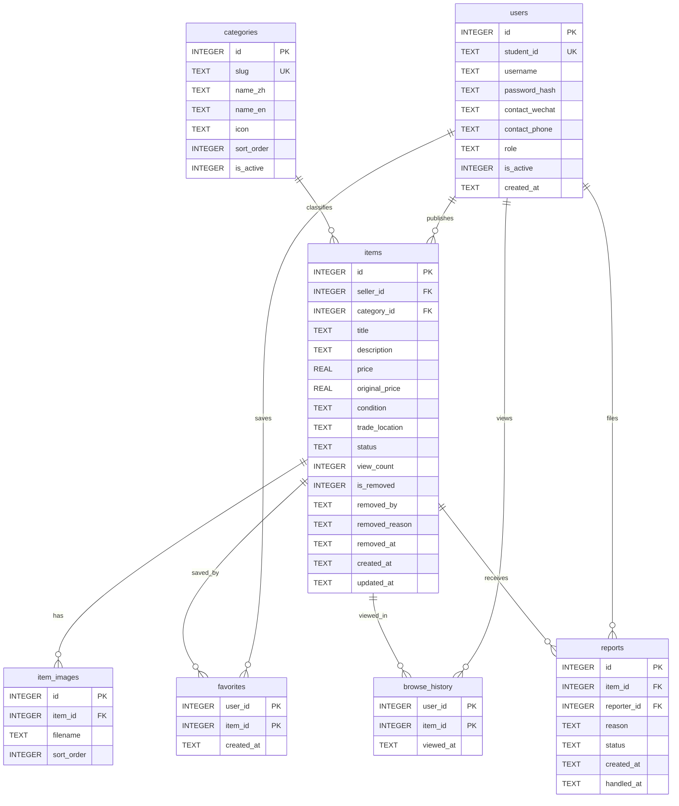

# 校园集市 · 数据库设计

> 对应文件：`schema.sql`、`app/queries.py`、`app/db.py`
> 数据库：SQLite 3（Python 标准库 `sqlite3`）

## 1. 设计目标

1. 支持学生发布、分类、标价、收藏、浏览和联系卖家。
2. 支持「在售 / 已售 / 暂停出售」三种商品状态，并保留历史记录。
3. 区分「管理员下架」与「卖家删除」，前者可恢复，后者不可恢复。
4. 支持 7 个校园高频分类，分类名称中英双语。
5. 支持管理员查看全站统计、处理举报与分类维护。
6. 保持结构简单，适合课程讲解与 SQL 演示；不使用 ORM，所有查询可直接阅读。

## 2. 实体关系



## 3. 关系与基数

| 关系 | 基数 | 说明 |
|---|---|---|
| users → items | 1:N | 一个学生可以发布多件商品；一件商品只有一个发布者 |
| categories → items | 1:N | 一个分类包含多件商品；一件商品属于一个分类 |
| items → item_images | 1:N | 一件商品最多 5 张图片，`sort_order=0` 为封面 |
| users ↔ items（favorites） | M:N | 一个用户收藏多件商品；一件商品可被多人收藏 |
| users ↔ items（browse_history） | M:N | 浏览记录按「用户 + 商品」去重，只保留最近一次时间 |
| users → reports | 1:N | 一个用户可提交多条举报 |
| items → reports | 1:N | 一件商品可被多人举报 |

## 4. 字段字典

### 4.1 users（用户）

| 字段 | 类型 | 约束 | 说明 |
|---|---|---|---|
| id | INTEGER | PK, AUTOINCREMENT | 用户 ID |
| student_id | TEXT | NOT NULL, UNIQUE | 学号 / 登录账号；管理员使用 `admin` |
| username | TEXT | NOT NULL | 昵称 |
| password_hash | TEXT | NOT NULL | Werkzeug 密码哈希（不存明文） |
| contact_wechat | TEXT | 可空 | 微信号 |
| contact_phone | TEXT | 可空 | 手机号；与微信至少填写一项才能发布 |
| role | TEXT | NOT NULL, CHECK `student/admin` | 角色 |
| is_active | INTEGER | NOT NULL, CHECK 0/1 | 账号启用状态；登录时校验 |
| created_at | TEXT | NOT NULL | 注册时间 |

### 4.2 categories（分类）

| 字段 | 类型 | 约束 | 说明 |
|---|---|---|---|
| id | INTEGER | PK | 分类 ID |
| slug | TEXT | NOT NULL, UNIQUE | URL 标识，如 `books` |
| name_zh | TEXT | NOT NULL | 中文名 |
| name_en | TEXT | NOT NULL | 英文名 |
| icon | TEXT | NOT NULL | 图标键：book/device/lamp/ball/shirt/pen/box |
| sort_order | INTEGER | NOT NULL | 首页、分类页排序 |
| is_active | INTEGER | NOT NULL, CHECK 0/1 | 停用后不在入口与发布下拉中出现，历史商品仍可访问 |

### 4.3 items（商品）

| 字段 | 类型 | 约束 | 说明 |
|---|---|---|---|
| id | INTEGER | PK | 商品 ID |
| seller_id | INTEGER | NOT NULL, FK → users.id | 发布者 |
| category_id | INTEGER | NOT NULL, FK → categories.id | 分类 |
| title | TEXT | NOT NULL | 商品名称（2–60 字符） |
| description | TEXT | NOT NULL | 描述（5–2000 字符） |
| price | REAL | NOT NULL, CHECK 0–99999 | 售价 |
| original_price | REAL | 可空, CHECK 0–99999 | 原价 |
| condition | TEXT | 可空, CHECK `new/like_new/good/fair` | 成色 |
| trade_location | TEXT | 可空 | 交易地点 |
| status | TEXT | NOT NULL, CHECK `on_sale/sold/unavailable` | 售卖状态 |
| view_count | INTEGER | NOT NULL, DEFAULT 0 | 浏览量（30 分钟内同会话去重） |
| is_removed | INTEGER | NOT NULL, CHECK 0/1 | 软删除标记 |
| removed_by | TEXT | 可空, CHECK `admin/seller` | 删除来源 |
| removed_reason | TEXT | 可空 | 下架 / 删除原因 |
| removed_at | TEXT | 可空 | 删除时间 |
| created_at | TEXT | NOT NULL | 发布时间 |
| updated_at | TEXT | NOT NULL | 最后修改时间 |

### 4.4 item_images（商品图片）

| 字段 | 类型 | 约束 | 说明 |
|---|---|---|---|
| id | INTEGER | PK | 图片 ID |
| item_id | INTEGER | NOT NULL, FK → items.id, ON DELETE CASCADE | 所属商品 |
| filename | TEXT | NOT NULL | 相对 `static/` 的路径，如 `uploads/<uuid>.png` 或 `img/placeholders/books-1.svg` |
| sort_order | INTEGER | NOT NULL | 0 为封面，依次递增 |

### 4.5 favorites（收藏）

| 字段 | 类型 | 约束 | 说明 |
|---|---|---|---|
| user_id | INTEGER | PK, FK → users.id, ON DELETE CASCADE | 用户 |
| item_id | INTEGER | PK, FK → items.id, ON DELETE CASCADE | 商品 |
| created_at | TEXT | NOT NULL | 收藏时间 |

复合主键 `(user_id, item_id)` 天然防止重复收藏。

### 4.6 browse_history（浏览记录）

| 字段 | 类型 | 约束 | 说明 |
|---|---|---|---|
| user_id | INTEGER | PK, FK → users.id, ON DELETE CASCADE | 用户 |
| item_id | INTEGER | PK, FK → items.id, ON DELETE CASCADE | 商品 |
| viewed_at | TEXT | NOT NULL | 最近浏览时间 |

同一商品重复浏览使用 `ON CONFLICT ... DO UPDATE` 更新时间，不产生重复行。

### 4.7 reports（举报）

| 字段 | 类型 | 约束 | 说明 |
|---|---|---|---|
| id | INTEGER | PK | 举报 ID |
| item_id | INTEGER | NOT NULL, FK → items.id, ON DELETE CASCADE | 被举报商品 |
| reporter_id | INTEGER | NOT NULL, FK → users.id, ON DELETE CASCADE | 举报人 |
| reason | TEXT | NOT NULL | 举报原因（5–200 字符） |
| status | TEXT | NOT NULL, CHECK `pending/resolved/dismissed` | 处理状态 |
| created_at | TEXT | NOT NULL | 提交时间 |
| handled_at | TEXT | 可空 | 处理时间 |

另有部分唯一索引：

```sql
CREATE UNIQUE INDEX idx_reports_pending_unique
ON reports(item_id, reporter_id) WHERE status = 'pending';
```

同一用户对同一商品最多保留一条待处理举报，已处理或驳回后可以再次举报。

## 5. 状态与软删除语义

### 5.1 商品状态

| status | 公开列表 | 详情 | 联系方式 | 允许新收藏 |
|---|---|---|---|---|
| `on_sale` | 显示 | 正常 | 登录后可见 | 是 |
| `sold` | 显示，灰化 | 显示「已售」提示 | 隐藏 | 否 |
| `unavailable` | 隐藏 | 公开用户看到「暂不出售」提示；本人 / 管理员看到完整页 | 隐藏 | 否 |

### 5.2 删除来源

| 来源 | `is_removed` / `removed_by` | 公开列表 | 发布者 | 管理员 | 可恢复 |
|---|---|---|---|---|---|
| 管理员下架 | 1 / `admin` | 隐藏，直达 404 | 「我的发布」显示原因，详情只读 | 可见、可恢复 | 是 |
| 卖家删除 | 1 / `seller` | 隐藏，直达 404 | 不可见 | 后台只读可见 | 否 |

软删除只改标记，不删除 `items` 行，也不清理图片、收藏、浏览记录和举报；图片文件保留用于管理员审计与可能的恢复。只有 `seed.py --reset` 会清空数据与上传文件。

## 6. 规范化说明

- **1NF**：所有字段为原子值；多值图片拆分为 `item_images`，不在 `items` 中存逗号分隔字符串。
- **2NF**：`favorites`、`browse_history` 使用复合主键，非主属性（时间）完全依赖整个主键。
- **3NF**：分类名称存放在 `categories`，商品只保存 `category_id`；卖家信息存放在 `users`，商品只保存 `seller_id`；不存在「商品 → 分类 → 分类名」的传递依赖。
- **受控冗余**：`items.view_count` 是计数缓存，用于排序与展示，避免每次聚合；更新在详情访问时原子 `+1`。`items` 同时保留 `created_at` 与 `updated_at`，属于审计字段。
- **双语名称**：分类的中英文名作为两列存储，保持一条分类对应一组名称，避免引入语言表导致查询复杂化；用户发布的标题和描述不翻译。

## 7. 索引设计

| 索引 | 字段 | 用途 |
|---|---|---|
| `idx_items_public` | `(is_removed, status, created_at DESC)` | 公开列表过滤与最新排序 |
| `idx_items_category` | `(category_id, is_removed, status)` | 分类页与分类计数 |
| `idx_items_seller` | `seller_id` | 我的发布 |
| `idx_items_views` | `view_count DESC` | 最热浏览 |
| `idx_images_item` | `(item_id, sort_order)` | 封面与图集 |
| `idx_favorites_user` | `user_id` | 我的收藏 |
| `idx_history_user` | `(user_id, viewed_at DESC)` | 浏览记录 |
| `idx_reports_status` | `(status, created_at)` | 后台举报列表 |
| `idx_reports_pending_unique` | `(item_id, reporter_id) WHERE status='pending'` | 待处理举报去重 |

## 8. 常用查询示例

### 8.1 公开商品列表（带分类、卖家、封面）

```sql
SELECT i.*, c.slug AS category_slug,
       c.name_zh, c.name_en,
       u.username AS seller_name,
       (SELECT filename FROM item_images
        WHERE item_id = i.id ORDER BY sort_order, id LIMIT 1) AS cover
FROM items i
JOIN categories c ON c.id = i.category_id
JOIN users u ON u.id = i.seller_id
WHERE i.is_removed = 0
  AND i.status IN ('on_sale', 'sold')
ORDER BY i.created_at DESC, i.id DESC
LIMIT 12 OFFSET 0;
```

### 8.2 关键词搜索（转义 LIKE 通配符）

```sql
SELECT *
FROM items
WHERE is_removed = 0
  AND status IN ('on_sale', 'sold')
  AND (title LIKE ? ESCAPE '\' OR description LIKE ? ESCAPE '\')
ORDER BY created_at DESC;
```

参数中的 `\`、`%`、`_` 会先被转义，避免用户输入 `%` 或 `_` 变成通配符。

### 8.3 分类商品数（公开可见口径）

```sql
SELECT c.id, c.slug, c.name_zh, c.name_en,
       (SELECT COUNT(*) FROM items i
        WHERE i.category_id = c.id
          AND i.is_removed = 0
          AND i.status IN ('on_sale', 'sold')) AS visible_count
FROM categories c
WHERE c.is_active = 1
ORDER BY c.sort_order, c.id;
```

### 8.4 我的收藏（含失效商品）

```sql
SELECT i.*, f.created_at AS favorite_created_at
FROM favorites f
JOIN items i ON i.id = f.item_id
WHERE f.user_id = ?
ORDER BY f.created_at DESC;
```

页面根据 `is_removed`、`status` 计算 `available / sold / invalid` 三种展示状态。

### 8.5 更新状态与软删除

```sql
UPDATE items
SET status = ?, updated_at = datetime('now', 'localtime')
WHERE id = ? AND seller_id = ? AND is_removed = 0;

UPDATE items
SET is_removed = 1, removed_by = 'seller',
    removed_reason = 'seller_deleted',
    removed_at = datetime('now', 'localtime'),
    updated_at = datetime('now', 'localtime')
WHERE id = ? AND seller_id = ?;
```

### 8.6 后台分类分布

```sql
SELECT c.name_zh, c.name_en, COUNT(i.id) AS item_count
FROM categories c
LEFT JOIN items i ON i.category_id = c.id AND i.is_removed = 0
GROUP BY c.id
ORDER BY c.sort_order;
```

## 9. 种子数据

`python seed.py --reset` 生成：

- 4 个用户：1 个管理员 + 3 个学生。
- 7 个分类。
- 28 件商品：18 在售、6 已售、2 暂停、1 管理员下架、1 卖家删除。
- 每件商品 2 张本地 SVG 占位图。
- 演示收藏（含已售 / 暂停 / 下架失效项）、浏览记录、1 条待处理举报。

商品按「分类轮转」插入，首页最新发布不会连续出现同一分类，便于演示和截图。

## 10. SQLite 实现细节

- 每个连接执行 `PRAGMA foreign_keys = ON`。
- 时间以 `YYYY-MM-DD HH:MM:SS` 文本保存，直接字符串排序即可，便于课程讲解；生产环境可改为 UTC 时间戳。
- 浏览记录使用 SQLite UPSERT：

```sql
INSERT INTO browse_history (user_id, item_id, viewed_at)
VALUES (?, ?, datetime('now', 'localtime'))
ON CONFLICT(user_id, item_id)
DO UPDATE SET viewed_at = excluded.viewed_at;
```

- 举报去重使用部分唯一索引 + `INSERT OR IGNORE`。
- 数据量小（课程演示），未引入连接池、全文索引或分库分表；索引覆盖主要过滤与排序路径。
