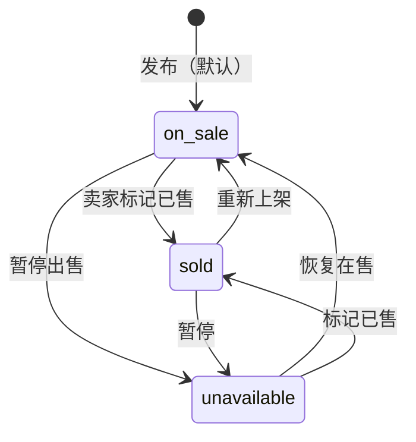

# 校园集市 · 功能与页面说明

## 1. 功能总览

校园集市面向本校学生，提供从「发布 → 浏览 → 联系 → 成交 → 更新状态」的完整闭环：

- 学生注册 / 登录 / 退出。
- 发布闲置：多图、分类、售价、原价、成色、描述、交易地点。
- 浏览：首页、全部商品、分类浏览、商品详情。
- 查找：关键词、分类、状态、价格 / 最新 / 浏览量排序、分页。
- 交易状态：在售 / 已售 / 暂停出售，发布者手动切换。
- 个人：我的发布、收藏、浏览记录、联系方式与密码修改。
- 治理：举报、管理员下架 / 恢复、分类维护、举报处理、全站统计。
- 双语：中文 / English，覆盖所有系统文案。

## 2. 路由与页面

### 2.1 公开页面

| 方法 | 路由 | 页面 | 说明 |
|---|---|---|---|
| GET | `/` | 首页 | 轮播、7 分类入口、最新发布、最热浏览、平台数据 |
| GET | `/items` | 全部商品 | 搜索、分类、状态、排序、分页 |
| GET | `/categories` | 分类浏览 | 7 个分类卡片与可见商品数 |
| GET | `/category/<slug>` | 分类商品 | 锁定分类，复用商品列表 |
| GET | `/item/<id>` | 商品详情 | 图片、价格、描述、卖家、状态、联系方式 |
| GET/POST | `/login` | 登录 | 学号 + 密码，支持 `next` 回跳 |
| GET/POST | `/register` | 注册 | 学号、昵称、密码、联系方式 |
| GET | `/lang/<zh|en>` | 语言切换 | 写入会话并回到当前页 |

公开列表只展示 `on_sale` 与 `sold`；`unavailable` 与所有软删除商品不出现。

### 2.2 登录后页面

| 方法 | 路由 | 功能 |
|---|---|---|
| GET/POST | `/publish` | 发布闲置；未填写联系方式时跳转个人中心 |
| GET/POST | `/item/<id>/edit` | 编辑标题、分类、价格、描述、图片、地点；仅本人或管理员 |
| POST | `/item/<id>/status` | 切换在售 / 已售 / 暂停出售；仅发布者 |
| POST | `/item/<id>/delete` | 卖家软删除；仅发布者 |
| POST | `/item/<id>/favorite` | 收藏 / 取消收藏；新增仅限在售 |
| POST | `/item/<id>/report` | 举报在售 / 已售商品 |
| GET | `/my/items` | 我的发布，按状态筛选，编辑商品 / 改状态 / 删除 |
| GET | `/my/favorites` | 我的收藏，含已售 / 失效条目 |
| GET | `/my/history` | 浏览记录，仅保留可公开访问的商品 |
| GET/POST | `/profile` | 昵称、微信、手机号、密码修改、个人统计 |
| POST | `/logout` | 退出登录 |

### 2.3 管理员页面

| 方法 | 路由 | 功能 |
|---|---|---|
| GET | `/admin` | 数据概览：用户、商品、状态、浏览量、待处理举报、分类分布 |
| GET | `/admin/items` | 全量商品筛选（含已下架 / 卖家删除） |
| POST | `/admin/items/<id>/remove` | 填写原因后下架；前台立即隐藏 |
| POST | `/admin/items/<id>/restore` | 仅恢复管理员下架的商品 |
| GET | `/admin/categories` | 分类列表、新增、编辑、启用 / 停用 |
| POST | `/admin/categories` | 新增分类 |
| POST | `/admin/categories/<id>/edit` | 编辑分类 |
| POST | `/admin/categories/<id>/toggle` | 启用 / 停用分类 |
| GET | `/admin/reports` | 待处理 / 已处理 / 已驳回 / 全部举报 |
| POST | `/admin/reports/<id>/resolve` | 标记已处理 |
| POST | `/admin/reports/<id>/dismiss` | 驳回举报 |
| POST | `/admin/reports/<id>/remove-item` | 下架被举报商品并处理举报 |

## 3. 角色与权限

| 操作 | 游客 | 学生 | 商品发布者 | 管理员 |
|---|---|---|---|---|
| 浏览公开商品 / 分类 / 详情 | ✓ | ✓ | ✓ | ✓ |
| 查看联系方式（在售对买家；本人 / 管理员不限状态） | — | ✓ | ✓ | ✓ |
| 发布商品 | — | ✓ | ✓ | ✓ |
| 编辑商品 | — | — | ✓ | ✓（未删除商品） |
| 切换商品状态 | — | — | ✓ | — |
| 卖家删除商品 | — | — | ✓ | — |
| 收藏 / 举报 | — | ✓ | 可收藏 | ✓ |
| 我的发布 / 收藏 / 历史 / 个人中心 | — | ✓ | ✓ | ✓ |
| 管理员下架 / 恢复 | — | — | — | ✓ |
| 分类维护 / 举报处理 / 全站统计 | — | — | — | ✓ |
| 查看已下架 / 卖家删除商品详情 | — | — | 仅自己的下架商品 | ✓ |

说明：管理员可以编辑任意未删除商品，但「切换状态」和「卖家删除」仍只属于发布者；管理员通过「下架 / 恢复」管理商品，不物理删除数据。

## 4. 商品状态机

状态规则：

- 新发布默认 `on_sale`。
- 三种状态之间允许自由切换，已售允许重新上架（买家反悔场景）。
- 状态切换写 `updated_at`，列表与详情实时反映。
- 已售：公开列表保留、卡片灰化、详情显示「已售」、联系方式隐藏、不可新增收藏。
- 暂停：公开列表、分类、首页、搜索均隐藏；直达详情显示「暂不出售」提示，联系方式与收藏不可用。
- 状态与软删除相互独立：已售 / 暂停商品也可以被管理员下架。

## 5. 软删除矩阵

| 删除来源 | 谁可操作 | 公开列表 | 直达详情 | 发布者「我的发布」 | 管理员后台 | 可恢复 |
|---|---|---|---|---|---|---|
| 管理员下架 | 管理员 | 隐藏 | 公开用户 404；发布者 / 管理员只读 | 显示「已下架」+ 原因 | 显示、可恢复 | 是 |
| 卖家删除 | 发布者 | 隐藏 | 所有人 404（管理员后台可只读查看） | 不显示 | 显示、只读 | 否 |

软删除不清理图片、收藏、浏览记录、举报；图片文件保留用于审计与管理员恢复。只有 `seed.py --reset` 会清空。

## 6. 核心用户流程

### 6.1 注册 → 发布

1. 学生打开 `/register`，填写学号、昵称、密码，至少填写微信或手机号。
2. 注册成功后自动登录并回到首页。
3. 进入 `/publish`，选择分类、填写名称、售价、描述，上传 1–5 张图片。
4. 选填原价、成色、交易地点。
5. 提交后默认状态为「在售」，跳转商品详情。

### 6.2 浏览 → 联系

1. 游客从首页、分类页或 `/items` 进入商品。
2. 使用关键词、分类、状态、排序筛选。
3. 打开详情；未登录时看到「登录后查看联系方式」。
4. 登录后，在售商品向买家显示卖家微信 / 手机号；已售 / 暂停 / 下架商品对买家隐藏，卖家本人与管理员仍可见。

### 6.3 成交 → 已售

1. 卖家在商品详情或 `/my/items` 把状态改为「已售」。
2. 公开列表仍保留该商品，但卡片灰化并标注「已售」。
3. 详情页显示「该商品已售出，不再接受新的咨询」，联系方式隐藏。
4. 买家反悔时，卖家可把状态改回「在售」。

### 6.4 暂停 → 恢复

1. 卖家把状态改为「暂停出售」。
2. 商品从首页、分类、搜索和公开列表消失。
3. 卖家在「我的发布」仍能看到并恢复；其他人直达详情只看到「暂不出售」。

### 6.5 卖家删除

1. 卖家在详情或「我的发布」点击删除，二次确认。
2. 商品从公开页面与「我的发布」消失。
3. 数据保留但不可恢复；管理员后台可只读查看。

### 6.6 收藏与浏览记录

- 只能新收藏在售商品；已售商品的既有收藏保留并标注「已售」，暂停 / 下架 / 删除后标注「已失效」，仍可取消收藏。
- 浏览记录只展示仍可公开访问的商品（在售 / 已售）；暂停 / 下架 / 删除自动隐藏，不显示失效卡片。
- 同一商品重复浏览按「用户 + 商品」去重，更新时间。

### 6.7 举报与管理员处理

1. 登录用户对非本人在售 / 已售商品提交 5–200 字举报原因。
2. 同一用户对同一商品只能有一条待处理举报。
3. 管理员在 `/admin/reports` 选择「标记已处理」「驳回」或「下架并处理」。
4. 「下架并处理」会把商品置为管理员下架，并把举报标记为已处理。

## 7. 表单校验规则

| 字段 | 规则 |
|---|---|
| 学号 | 4–20 位字母或数字，唯一 |
| 昵称 | 2–30 字符 |
| 密码 | 至少 8 位，包含字母和数字 |
| 联系方式 | 微信 / 手机号至少一项；发布前再次检查 |
| 商品名称 | 2–60 字符 |
| 商品描述 | 5–2000 字符 |
| 售价 | 0–99999 的有限数字 |
| 原价 | 选填，0–99999 的有限数字 |
| 成色 | 空或 `new/like_new/good/fair` |
| 分类 | 必须是启用中的分类 |
| 交易地点 | ≤ 60 字符 |
| 图片 | 1–5 张，jpg / jpeg / png / webp，单张 ≤ 5 MB，校验文件头 |
| 举报原因 | 5–200 字符 |
| 管理员下架原因 | 2–200 字符 |
| 分类标识 | 2–30 位小写字母、数字或连字符，唯一 |
| 分类中英文名 | 1–30 字符 |

## 8. 边界与安全规则

- 所有 POST 必须携带会话 CSRF token，缺失 / 错误返回 400。
- 表单校验失败保留用户输入；错误文案随语言切换。
- `next` 只允许站内相对路径，阻止开放重定向。
- 图片使用 UUID 文件名，忽略原始文件名，阻止路径穿越。
- 权限在路由层检查：非发布者编辑 / 改状态 / 删除返回 403；非管理员访问 `/admin/*` 返回 403。
- 搜索对 `%`、`_`、`\` 做 LIKE 转义。
- 分页页码越界自动收敛到最后一页。
- 浏览量 30 分钟内同一会话去重；发布者浏览不计数。
- 分类停用后不再出现在首页、分类页和发布下拉，但历史商品仍可在 `/items` 访问。
- 分类计数使用「在售 + 已售」的公开可见口径，与默认列表一致。
- 商品被卖家删除或管理员下架后，编辑 / 改状态 / 收藏 / 举报均被阻止。

## 9. 需求对照表

| 原始需求 | 实现位置 |
|---|---|
| 首页导航、轮播、热门展示、7 分类入口 | `/`、`templates/index.html`、`main.build_home_data` |
| 全部商品：价格 / 最新 / 浏览量排序 | `/items`、`queries.fetch_items` |
| 商品卡片：图片、名称、价格、状态、发布时间 | `partials/item_card.html` |
| 分类浏览 7 类 | `/categories`、`/category/<slug>`、`categories` 表 |
| 发布：多图、名称、分类、售价、简介 | `/publish`、`items.publish` |
| 选填：原价、成色、交易地点 | 发布 / 编辑表单 |
| 默认在售 + 手动切换三种状态 | `items.update_status`、`status` 字段 |
| 我的发布：改价、改描述、改状态、删除 | `/my/items`、`items.edit`、`items.update_status`、`items.delete` |
| 个人中心：登录、收藏、浏览记录、联系方式 | `/profile`、`/my/favorites`、`/my/history` |
| 商品表字段 | `items` 表（见数据库设计） |
| 后台审核、删除违规、分类管理、全站数据 | `/admin/*` |
| 浅蓝白、圆角、状态色标签 | `static/css/style.css` 设计变量与组件 |
| 完整使用流程 | 本文第 6 节 |
| 创新点：校园封闭、实时状态、轻量、分类系统 | 报告素材第 8 节 |

## 10. 截图清单

已生成于 [`docs/screenshots/`](screenshots/)：

| 文件 | 内容 |
|---|---|
| `home-desktop.png` | 中文首页：英雄区、状态面板、轮播、分类、最新发布 |
| `items-desktop.png` | 全部商品：筛选、排序、商品卡片 |
| `detail-desktop.png` | 商品详情：图集、价格、元信息、卖家、登录提示 |
| `home-en.png` | 英文首页，验证双语切换 |
| `publish-desktop.png` | 发布表单：字段、图片上传、侧栏提交 |
| `admin-desktop.png` | 后台概览：统计卡、分类分布 |
| `admin-en.png` | 英文后台概览，验证双语后台 |
| `admin-reports.png` | 举报处理：待处理举报与操作 |
| `home-mobile.png` | 375px 移动端首页 |
| `items-mobile.png` | 375px 移动端商品列表 |
| `mobile-menu.png` | 移动端展开菜单与语言切换 |

截图使用演示数据，日期为运行时刻；如界面有后续调整，按同一清单重新截取即可。
