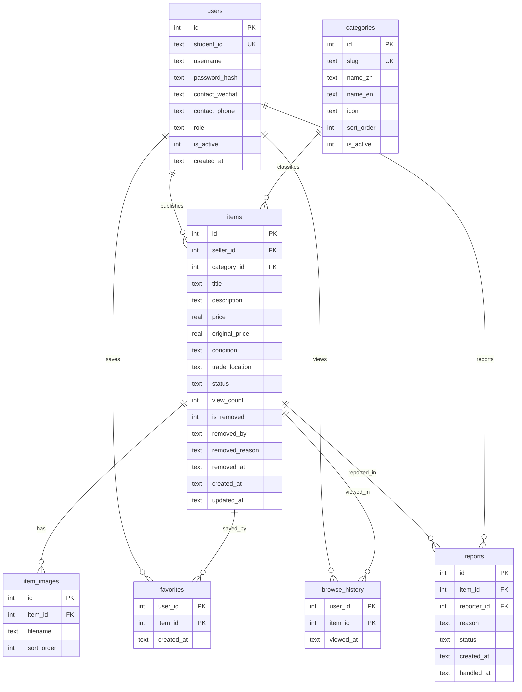

# 校园集市 Campus Market — 设计文档

日期：2026-11-01
状态：待确认
项目路径：`campus-market/`

## 1. 项目意图

为高校学生提供一个仅限校园场景使用的二手闲置发布与浏览网站。学生可以自主发布闲置、选择分类、标价、上传图片，并随时把商品状态切换为「在售 / 已售 / 暂停出售」。浏览者可以按分类、关键词、价格和热度查找商品，登录后收藏、查看浏览记录并获取卖家联系方式。

核心要解决的问题：校园二手群信息杂乱、已售商品仍被反复询问、分类不清、交易状态不透明。

成功标准：

- 学生能在 1 分钟内完成一次发布。
- 已售 / 暂停商品在列表与详情页有明确视觉区分，且已售商品无法发起新咨询。
- 所有页面在中英文之间可切换，切换语言不丢失当前页面。
- 管理员能独立完成违规商品下架、分类维护、举报处理和数据查看。
- 项目可在 Windows 上通过三条命令启动，所有数据落在本地 SQLite，无需外部服务或 CDN。

## 2. 目标与非目标

### 目标

1. 真实的注册、登录、会话与角色权限（学生 / 管理员）。
2. 完整的商品发布、编辑、状态切换、删除闭环。
3. 7 个校园高频分类，支持分类浏览、关键词搜索、排序、分页。
4. 收藏、浏览记录、个人资料与联系方式维护。
5. 管理员后台：数据概览、商品审核与下架、分类管理、举报处理。
6. 中英双语界面，覆盖所有系统文案、校验提示和状态标签。
7. 可直接用于课程演示的种子数据、测试与文档。

### 非目标（本版本不做）

- 站内即时聊天、订单、支付、担保交易。
- 真实校园统一身份认证（SSO）；仅以学号作为校内账号标识。
- 邮箱验证、短信验证、找回密码。
- 多校区、多租户隔离。
- 移动 App、小程序。
- 推荐算法、图片 CDN、对象存储。
- 管理员用户管理（封禁账号）——v1 只做商品、分类、举报管理。

### 反目标（做到这些也算失败）

- 只在前端用 localStorage 模拟数据，没有真实数据库。
- 依赖 CDN、在线字体或外网图片，断网无法演示。
- 功能堆砌导致启动或演示不稳定。
- 已售商品仍能显示联系方式或发起咨询。
- 中英文只翻译导航，表单错误、后台、状态标签仍是单一语言。

## 3. 约束与已定决策

| 项 | 决策 |
|---|---|
| 技术栈 | Python 3.10+ / Flask 3.x / SQLite / Jinja2 / 原生 CSS + 原生 JS |
| 运行方式 | 本地 `python -m venv` + `pip install -r requirements.txt` + `python run.py` |
| 数据库 | SQLite，首次启动自动建表；`seed.py` 灌入演示数据 |
| 前端 | 服务端渲染，无构建步骤，无 npm，无 CDN |
| 语言 | 中英双语，服务端 i18n，默认中文，会话保存语言偏好 |
| 图片 | 本地文件上传，保存到 `static/uploads/`；种子数据使用本地生成的 SVG 占位图 |
| 品牌 | 中文「校园集市」，英文「Campus Market」 |
| 删除策略 | 软删除（`is_removed` + `removed_by`）；仅「管理员下架」可恢复，用户自行删除不可恢复 |
| 测试 | pytest + Flask test client，临时数据库 |
| 交付 | 可运行网站 + README + 数据库/功能/UI/报告/演示文档 |

## 4. 页面与路由

### 4.1 公共页面（无需登录即可浏览）

| 路由 | 页面 | 说明 |
|---|---|---|
| `GET /` | 首页 | 轮播（平台介绍 / 交易规则 / 状态机制）、7 分类入口、最新发布、最热浏览、平台数据 |
| `GET /items` | 全部商品 | 关键词 `q`、分类 `category`、状态 `status`、排序 `sort=latest|price_asc|price_desc|views`、分页 `page` |
| `GET /categories` | 分类浏览 | 7 个分类卡片，显示各分类可见商品数（在售 + 已售，不含暂停/下架），与默认列表一致 |
| `GET /category/<slug>` | 分类商品 | 复用商品列表组件，锁定分类 |
| `GET /item/<id>` | 商品详情 | 多图、价格、原价、成色、描述、地点、卖家、状态；收藏、举报、联系方式 |
| `GET /login` / `POST /login` | 登录 | 学号 + 密码；支持 `next` 回跳 |
| `GET /register` / `POST /register` | 注册 | 学号、昵称、密码、确认密码、联系方式（至少一项） |
| `POST /logout` | 退出 | 清空会话 |
| `GET /lang/<zh|en>` | 语言切换 | 写入会话；带 `next` 回到原页面 |

公开列表规则：

- 「在售」和「已售」都出现在公开列表；已售卡片灰色化并标注。
- 「暂停出售」不出现在任何公开列表 / 分类 / 首页 / 搜索结果；直达详情时显示「暂不出售」提示页，联系方式与收藏不可用。
- 被管理员下架的商品不出现在公开页面，直达详情对公开用户返回 404；发布者与管理员可看到只读的「已下架」提示及原因。卖家自行删除的商品对公开用户与发布者返回 404，管理员可在后台查看只读记录。

### 4.2 登录后页面

| 路由 | 页面 | 说明 |
|---|---|---|
| `GET/POST /publish` | 发布闲置 | 必填：图片（1–5 张）、名称、分类、售价、描述；选填：原价、成色、交易地点 |
| `GET/POST /item/<id>/edit` | 编辑商品 | 仅发布者或管理员；可改全部字段 |
| `POST /item/<id>/status` | 切换状态 | 仅发布者；在售 / 已售 / 暂停出售 |
| `POST /item/<id>/delete` | 删除商品 | 仅发布者；软删除 |
| `GET /my/items` | 我的发布 | 按状态筛选；快捷改价、改描述、改状态、删除 |
| `GET /my/favorites` | 我的收藏 | 收藏列表，可取消收藏 |
| `GET /my/history` | 浏览记录 | 最近浏览，按时间倒序，去重 |
| `GET/POST /profile` | 个人中心 | 昵称、联系方式、修改密码；展示我的统计 |
| `POST /item/<id>/favorite` | 收藏 / 取消 | 登录后可操作，返回原页面 |
| `POST /item/<id>/report` | 举报商品 | 登录后可举报，填写原因 |

### 4.3 管理员页面

| 路由 | 页面 | 说明 |
|---|---|---|
| `GET /admin` | 后台概览 | 用户数、商品数、在售/已售数、总浏览量、待处理举报、分类分布 |
| `GET /admin/items` | 商品管理 | 全量商品（含已售、暂停、管理员下架、卖家已删除），按关键词/分类/状态/删除来源筛选 |
| `POST /admin/items/<id>/remove` | 下架商品 | 必填下架原因；仅对未删除商品生效；前台立即隐藏 |
| `POST /admin/items/<id>/restore` | 恢复商品 | 仅恢复 `removed_by='admin'` 的商品；卖家自行删除的不可恢复 |
| `GET /admin/categories` | 分类管理 | 列表、新增、编辑、启用/停用 |
| `POST /admin/categories` | 新增分类 | 中英文名、slug、图标、排序 |
| `POST /admin/categories/<id>/edit` | 编辑分类 | 同上 |
| `POST /admin/categories/<id>/toggle` | 启停分类 | 停用后不在首页 / 发布下拉 / 分类页出现，历史商品仍可访问 |
| `GET /admin/reports` | 举报处理 | 待处理 / 已处理；可下架商品、标记已处理、驳回 |

权限规则：

- 未登录访问发布、收藏、个人中心 → 跳转登录并带 `next`。
- 非发布者编辑 / 改状态 / 删除 → 403。
- 非管理员访问 `/admin/*` → 403。
- 管理员可下架任意未删除商品，也可以查看已下架/已删除商品的详情（只读）；管理员不物理删除商品，也不恢复卖家自行删除的商品。

## 5. 商品状态机制

| 状态 | 代码 | 公开列表 | 详情页 | 联系方式 | 视觉 |
|---|---|---|---|---|---|
| 在售 | `on_sale` | 显示 | 正常 | 登录后可见 | 绿色标签 |
| 已售 | `sold` | 显示 | 灰色化 | 对买家隐藏；本人/管理员可见 | 灰色标签 |
| 暂停出售 | `unavailable` | 隐藏 | 显示「暂不出售」提示，收藏不可用 | 对买家隐藏；本人/管理员可见 | 黄色标签 |

被删除不是一种状态，而是独立的下架标记：

| 删除来源 | `removed_by` | 公开列表 / 详情 | 发布者可见 | 管理员 | 可恢复 |
|---|---|---|---|---|---|
| 管理员下架 | `admin` | 列表隐藏，详情 404 | 我的发布中显示「已下架」与原因，详情只读 | 可见、可恢复 | 是 |
| 卖家删除 | `seller` | 列表隐藏，详情 404 | 从前台与「我的发布」消失 | 后台列表可见（只读） | 否 |

规则：

- 新发布商品默认 `on_sale`。
- 发布者可在三种状态间自由切换；已售商品允许重新上架（买家反悔场景）。
- 已售商品保留记录，不删除；保留在公开列表与搜索结果，但首页「热门」只取在售。
- 状态切换写 `updated_at`，列表与详情实时反映，无需缓存。
- 管理员下架 / 卖家删除均只改标记，不物理删除数据行，也不删除图片文件、收藏、浏览记录与举报；软删除数据保留用于审计与举报追溯。仅 `seed.py --reset` 会清理全部数据与图片。
- 被下架 / 已删除商品不可编辑、不可切换状态、不可新增收藏、不可举报。
- 已售商品不可新增收藏，但既有收藏保留并在收藏页标注「已售」；暂停 / 下架 / 删除商品的既有收藏显示「已失效」，可取消收藏、不可跳转。

## 6. 数据模型

### 6.1 实体关系



### 6.2 表设计要点

- `users.student_id` 唯一，作为登录账号；`role` 取 `student|admin`；密码使用 Werkzeug `generate_password_hash`（默认 scrypt，本机实测）。
- `categories` 内置 7 类，中英文名分列存储；`slug` 用于 URL；`is_active=0` 时不在入口展示。
- `items.condition` 取 `new|like_new|good|fair`，可空；`status` 取 `on_sale|sold|unavailable`，默认 `on_sale`。
- `items.is_removed` + `removed_by`（`admin|seller`）+ `removed_reason` + `removed_at` 实现区分来源的软删除；管理员下架可恢复，卖家删除不可恢复。
- `item_images` 一张商品多图，`sort_order=0` 为封面；软删除不删除图片记录与文件，保证管理员可恢复与审计；仅重置数据库时统一清理。
- `favorites` 与 `browse_history` 均为复合主键，天然去重；浏览记录以 upsert 更新时间。
- `reports.status` 取 `pending|resolved|dismissed`。
- 金额以 `REAL` 存储，展示保留两位小数；范围为 0–99999，原价可为空。
- 时间统一以本地时间 `YYYY-MM-DD HH:MM:SS` 文本存储，便于 SQLite 排序与课程讲解。

### 6.3 索引

- `items(is_removed, status, created_at DESC)`、`items(category_id, is_removed, status)`、`items(seller_id)`、`items(view_count DESC)`
- `item_images(item_id, sort_order)`
- `favorites(user_id)`、`browse_history(user_id, viewed_at DESC)`
- `reports(status, created_at)`

### 6.4 外键与约束

- 开启 `PRAGMA foreign_keys = ON`。
- `ON DELETE CASCADE`：item_images、favorites、browse_history、reports 随商品物理删除；应用层只做软删除，级联仅作为数据库维护时的安全网。
- 用户不物理删除，避免商品与举报失去作者。
- 分类不物理删除，只停用。

## 7. 关键业务规则

1. **发布前置**：发布者必须至少填写一种联系方式（微信或手机号），否则跳转个人中心补全。
2. **图片**：1–5 张，支持 jpg/jpeg/png/webp，单张 ≤ 5 MB；服务端校验扩展名与文件头；文件名使用 UUID。
3. **搜索**：标题与描述 `LIKE '%q%'`，大小写不敏感；空结果给出空状态与建议。
4. **排序**：最新（`created_at DESC`）、价格升/降、浏览量降序；已售商品参与排序但卡片灰化。
5. **分页**：每页 12 条，保留其余查询参数。
6. **浏览量**：访问详情页且非发布者时 +1；同一会话 30 分钟内重复访问不重复计数。此去重可用会话内集合实现，简单且够用。
7. **收藏**：仅登录用户；仅可收藏在售商品，重复点击切换；商品变为已售后既有收藏保留并标注「已售」，暂停/下架/删除后标注「已失效」且不可跳转，仍可取消收藏。
8. **举报**：登录用户可对非本人、且在售或已售的商品举报；同一用户对同一商品只保留一条待处理举报。
9. **语言**：切换语言后回到当前页面；用户发布的标题与描述保持原文，不自动翻译；分类名、成色、状态、地点建议、系统文案全部双语。
10. **联系方式**：仅在详情页且商品为在售时向登录用户展示；卖家本人与管理员始终可见。
11. **首页热门**：只统计在售商品，按浏览量取前 8；最新发布取全部非下架且非暂停商品前 8。
12. **删除**：卖家删除后商品立即从公开页面与「我的发布」消失，记录保留但不可恢复；管理员下架后从公开页面消失，卖家仍可在「我的发布」看到原因，管理员可恢复。
13. **已删除 / 已下架的直达访问**：公开用户与发布者访问卖家已删除商品均为 404；管理员下架商品对公开用户 404，对发布者显示只读「已下架」提示，对管理员显示只读详情与原因。所有只读状态均禁止编辑、改状态、收藏、举报。
14. **计数口径**：分类卡片与「全部分类」使用可见商品数（在售 + 已售，排除暂停/下架/删除）；后台「商品总数」排除全部已删除，另单独列出「已下架」「卖家已删除」，分类分布按未删除商品统计。
15. **浏览记录**：只展示仍可公开访问的商品（在售 / 已售）；商品变为暂停、下架或删除后自动从记录中隐藏，不显示失效卡片。收藏与浏览记录采用不同策略：收藏保留失效条目供用户清理，历史记录不保留。

## 8. 界面与视觉设计

### 8.1 设计方向

「清晨校园公告栏」：浅蓝与白色为底，像贴在公告栏上的纸卡；圆角、轻阴影、清晰的层级；不用夸张渐变和模板化后台风格。

### 8.2 设计变量

| 变量 | 值 | 用途 |
|---|---|---|
| `--ink` | `#102A43` | 主文字、标题 |
| `--muted` | `#64748B` | 次要文字 |
| `--primary` | `#2E7CF6` | 按钮、链接、选中态 |
| `--primary-dark` | `#1D5FD1` | 悬停 |
| `--sky-50` | `#F3F8FF` | 页面底色 |
| `--sky-100` | `#E3EFFF` | 标签、分区底色 |
| `--line` | `#DCE7F5` | 边框 |
| `--surface` | `#FFFFFF` | 卡片 |
| `--price` | `#E4572E` | 价格 |
| `--success` | `#188A4C` | 在售 |
| `--warning` | `#B7791F` | 暂停 |
| `--sold` | `#7B8794` | 已售 |
| `--radius` | `18px` | 卡片圆角 |

字体：`"PingFang SC", "Microsoft YaHei", "Noto Sans SC", system-ui, sans-serif`；标题字重 700–800，数字使用 `font-variant-numeric: tabular-nums`。不加载外部字体。

### 8.3 组件规范

- **导航栏**：左侧 logo（循环箭头 + 校园集市 / Campus Market），中间导航，右侧语言切换与用户菜单；移动端折叠为汉堡菜单。
- **商品卡片**：4:3 图片、状态标签叠于图片左上、标题两行截断、价格橙红、原价删除线、成色与分类小标签、发布时间与浏览量；已售整卡降低饱和度并加灰色蒙层。
- **状态标签**：圆点 + 文本，绿色 / 灰色 / 琥珀色；三处统一：卡片、详情、我的发布。
- **按钮**：主按钮实心蓝、次按钮描边、危险操作红色描边并二次确认。
- **表单**：标签在上，必填星号，错误红字贴字段；图片上传区支持预览、删除、拖拽。
- **空状态**：插画式 SVG + 一句引导 + 行动按钮。
- **轮播**：3 张，自动切换 6 秒，悬停暂停，圆点可点，支持键盘；无外部库。
- **后台**：左侧固定导航，右侧内容；统计卡 + 表格 + 筛选；不使用第三方后台模板。
- **响应式**：≥1100px 四列，≥800px 三列，≥560px 两列，其余单列；导航与表格横向滚动。

### 8.4 无障碍与细节

- 所有图片有 `alt`；表单控件有 `label`；焦点态清晰可见。
- 状态不只靠颜色，同时有文字。
- 对比度满足 WCAG AA。
- Flash 消息统一顶部提示，自动消失可手动关闭。
- 删除、下架、标记已售均有确认弹窗。

## 9. 国际化方案

- `i18n.py` 维护 `TRANSLATIONS = {"zh": {...}, "en": {...}}`，键为语义化字符串（如 `nav.items`、`status.on_sale`、`flash.login_required`）。
- Jinja 全局函数 `t(key, **kwargs)`；Python 端使用同一函数。
- `get_locale()` 读取 `session["lang"]`，默认 `zh`；`<html lang="zh-CN|en">`。
- 分类、成色、状态、地点建议均有中英文映射；用户生成内容不翻译。
- 日期按语言格式化：中文 `2026年11月1日`，英文 `1 Nov 2026`。
- 语言切换链接携带 `next`，仅允许站内相对路径，防止开放重定向。

## 10. 种子数据与演示账号

初始化命令：`python seed.py --reset`（删除并重建数据库、生成占位图、写入演示数据）。

| 角色 | 账号（学号） | 密码 | 昵称 |
|---|---|---|---|
| 管理员 | `admin` | `Admin@12345` | 平台管理员 |
| 学生 | `2023001` | `Demo@12345` | 林小雨 |
| 学生 | `2023002` | `Demo@12345` | 陈子昂 |
| 学生 | `2023003` | `Demo@12345` | 苏晴 |

种子内容：

- 7 个分类：教材书籍、电子数码、生活用品、运动健身、美妆衣物、文具文创、其他闲置；中英文名、图标、排序。
- 约 28 件商品，覆盖 7 类，价格 5–89 元（结构支持 0–99999），成色与地点多样；约 6 件已售、2 件暂停出售、1 件管理员下架、1 件卖家已删除，其余在售。
- 商品图片为本地 SVG 占位图（按分类配色 + 图标 + 英文分类名），用户上传的真实图片优先。
- 演示学生的收藏、浏览记录、个人联系方式。
- 1 条待处理举报用于后台演示。
- 发布时间分布在最近 30 天，浏览量 0–300，便于首页热门排序。

## 11. 技术架构与目录

```
campus-market/
├─ run.py                     # 启动入口
├─ config.py                  # 配置（SECRET_KEY、数据库路径、上传限制）
├─ requirements.txt           # Flask、pytest
├─ schema.sql                 # 建表、索引、约束
├─ seed.py                    # 重置数据库 + 演示数据 + SVG 占位图
├─ README.md                  # 中英双语运行说明
├─ .gitignore
├─ app/
│  ├─ __init__.py             # create_app 工厂、蓝图注册、错误页、Jinja 全局
│  ├─ db.py                   # get_db / close_db / init_db / 查询辅助
│  ├─ i18n.py                 # 双语字典与 t()
│  ├─ security.py             # 登录装饰器、CSRF、密码校验、上传校验
│  ├─ utils.py                # 格式化、分页、状态映射
│  └─ blueprints/
│     ├─ auth.py              # 注册/登录/退出
│     ├─ main.py              # 首页/分类/语言/错误
│     ├─ items.py             # 列表/详情/发布/编辑/状态/删除/收藏/举报
│     ├─ account.py           # 我的发布/收藏/历史/个人中心
│     └─ admin.py             # 后台
├─ templates/
│  ├─ base.html
│  ├─ partials/ (nav, footer, flash, item_card, pagination, icons, empty_state)
│  ├─ index.html, items.html, categories.html, item_detail.html
│  ├─ publish.html, edit_item.html
│  ├─ my_items.html, favorites.html, history.html, profile.html
│  ├─ login.html, register.html
│  ├─ admin/ (dashboard, items, categories, reports)
│  └─ errors/ (403, 404, 500)
├─ static/
│  ├─ css/style.css
│  ├─ js/app.js
│  ├─ img/logo.svg, placeholders/*.svg
│  └─ uploads/.gitkeep
├─ tests/
│  ├─ conftest.py
│  ├─ test_auth.py
│  ├─ test_items.py
│  ├─ test_status.py
│  ├─ test_account.py
│  ├─ test_admin.py
│  └─ test_i18n.py
└─ docs/
   ├─ 01-数据库设计.md
   ├─ 02-功能与页面说明.md
   ├─ 03-UI设计说明.md
   ├─ 04-Capstone报告素材.md
   └─ 05-演示与答辩脚本.md
```

### 11.1 安全与健壮性

- 密码哈希、登录会话、`SECRET_KEY` 环境变量覆盖。
- 所有写操作使用 POST + CSRF token（会话级，所有表单统一注入）。
- 上传：扩展名白名单 + 文件头校验 + 大小限制 + UUID 文件名；禁止路径穿越。
- 权限检查集中在装饰器与辅助函数；对象级校验（只能改自己的商品）。
- Jinja 自动转义；搜索词不拼 SQL，全部参数化查询。
- 404 / 403 / 500 自定义页面；错误信息不泄露堆栈。
- `next` 跳转只允许站内相对路径。
- 举报与下架原因长度限制，避免超长文本破坏布局。

## 12. 测试计划

使用 pytest + Flask test client + 临时 SQLite 文件；每个测试独立建库。

覆盖：

1. 注册：成功、重复学号、密码不一致、弱密码、缺少联系方式。
2. 登录 / 退出：正确、错误密码、未登录访问受限页、`next` 回跳。
3. 发布：必填校验、图片数量与格式、默认状态、成功入库。
4. 编辑与权限：本人可改、他人 403、管理员可改。
5. 状态：在售 → 已售 → 在售；暂停后从公开列表消失、直达显示提示；已售详情隐藏联系方式。
6. 删除：卖家删除后公开页与「我的发布」均不可见且不可恢复；管理员下架后前台 404、卖家可见原因、管理员可恢复；卖家删除的记录管理员可见但无恢复按钮。
7. 收藏 / 浏览记录：仅能收藏在售；已售收藏保留标注；暂停/下架收藏显示失效；记录去重与时间排序。
8. 搜索 / 排序 / 分页：关键词、价格排序、页码边界；分类计数与默认列表数量一致。
9. 管理员：非管理员 403；下架后前台消失；恢复；分类新增与停用；举报处理；后台统计排除已删除商品。
10. 国际化：切换语言后页面文案变化、当前路径保持。
11. 安全：CSRF 缺失被拒绝；上传非图片被拒绝；无法编辑他人商品。

验收命令：`pytest -q` 全部通过；`python seed.py --reset && python run.py` 可正常演示。

## 13. 文档交付

1. `README.md`：项目简介、技术栈、目录、三步启动、演示账号、常见问题（中英双语）。
2. `docs/01-数据库设计.md`：ER 图、关系说明、字段字典、主外键、索引、3NF 说明。
3. `docs/02-功能与页面说明.md`：页面清单、路由、角色权限、状态机、业务流程、边界规则。
4. `docs/03-UI设计说明.md`：配色、字体、组件、响应式、无障碍与截图说明。
5. `docs/04-Capstone报告素材.md`：中英文摘要、背景与问题、目标、技术选型、系统架构、数据库设计、功能实现、创新点、测试与结果、局限与展望、结论；可直接摘入报告。
6. `docs/05-演示与答辩脚本.md`：5–8 分钟演示顺序、账号、讲解要点、常见提问与回答。

文档语言与截图约定：`docs/01–05` 正文用中文，`docs/04` 额外包含完整英文摘要与英文结论，便于英文报告直接使用；README 中英双语。文档不内嵌截图，改为提供「截图清单 + 每张截图应展示的要点」，由你在运行网站后按清单截取；这样避免文档体积膨胀，也保证截图与最终界面一致（若你提供课程官方模板或评分细则，我会按其章节重排文档）。

## 14. 验收标准

- [ ] 三条命令可启动，首页 200，无控制台报错。
- [ ] 7 个分类均可浏览，分类数量与商品一致。
- [ ] 注册 → 登录 → 发布（含多图）→ 我的发布 → 改为已售 → 买家端灰化且联系方式不可见（本人/管理员可见）。
- [ ] 暂停出售后公开列表与搜索均不出现，本人仍可见。
- [ ] 编辑、删除仅本人可操作；他人访问返回 403。
- [ ] 卖家删除后不可恢复；管理员下架后卖家在「我的发布」看到原因，管理员可恢复；公开用户直达均为 404。
- [ ] 收藏、浏览记录、个人资料修改生效；已售 / 失效收藏的展示与取消符合规则。
- [ ] 分类卡片数量与进入分类后的默认列表数量一致。
- [ ] 管理员可下架 / 恢复商品、增改分类、处理举报、查看统计；卖家已删除商品无恢复按钮。
- [ ] 中英文切换覆盖导航、表单、校验、状态、后台、空状态。
- [ ] 移动端 375px 宽度无横向溢出，卡片单列可读。
- [ ] `pytest -q` 全部通过。
- [ ] 六份文档齐全，报告素材包含中英文摘要。

## 15. 由我代做的决定（可推翻）

1. 品牌名「校园集市 / Campus Market」。
2. 采用带来源的软删除：管理员下架可恢复，卖家删除不可恢复；两者都保留数据行与图片，用于审计。
3. 暂停出售商品在公开列表隐藏，但详情直达时显示「暂不出售」提示，避免死链。
4. 已售商品保留在公开列表与搜索结果中（灰化），首页热门仅取在售；已售不可新增收藏，既有收藏保留并标注。
5. 图片上限 5 张、单张 5 MB，格式 jpg/png/webp。
6. 列表每页 12 条。
7. 增加「举报」功能，让管理员审核有明确入口。
8. 增加关键词搜索与价格排序（在原需求排序基础上补齐）。
9. 加入 CSRF、密码强度、上传文件头校验等安全措施。
10. 种子数据使用本地 SVG 占位图，保证离线演示效果。
11. 管理员不提供用户封禁，只做商品 / 分类 / 举报管理。
12. 用户发布内容不随界面语言翻译，只翻译系统文案。
13. 文档正文中文 + 英文摘要/结论，截图以清单形式提供，不内嵌。
14. 分类计数采用「可见商品数」（在售 + 已售），后台统计排除已删除。

## 16. 风险与应对

| 风险 | 应对 |
|---|---|
| Windows 编码问题（中文输出乱码） | 统一 UTF-8，模板与响应指定 charset，README 说明终端编码 |
| 图片上传依赖 Pillow | 不引入 Pillow，使用文件头校验，减少安装失败 |
| 双语遗漏 | 建立翻译键清单，测试遍历关键页面断言切换后无中文残留（后台/表单） |
| 演示数据图片观感差 | 生成分类配色 SVG 占位图，版式统一；README 说明可替换真实图片 |
| 时间/时区 | 统一本地时间文本存储，报告注明简化处理 |
| 课程要求差异 | 文档按 Capstone 报告结构组织，可裁剪为任意模块报告 |
